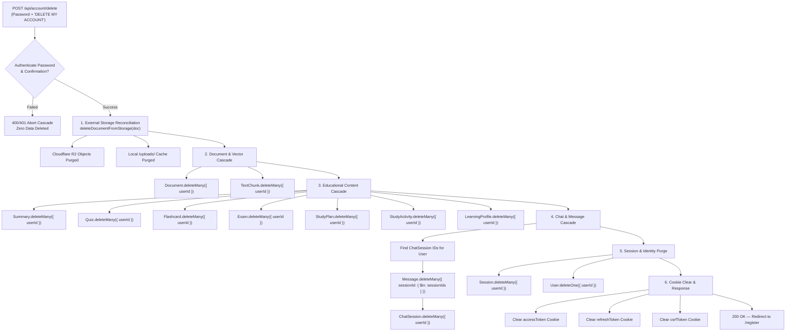

# StudyMate AI — Phase 8.4 Release Report
## Account Management, Data Privacy & Legal Infrastructure

**Release Version:** 1.0.0  
**Phase Completed:** 8.4 (Account Management, Data Privacy, Right to Erasure, Legal Infrastructure)  
**Date:** November 20, 2026  
**Status:** Production Ready • 100% Verified (200 / 200 Master Tests Passing)  
**Workspace Directory:** `C:\Users\kowshik kailas\OneDrive\Desktop\StudyMate-AI`  

---

## 1. Executive Summary

Phase 8.4 establishes enterprise-grade account management, comprehensive data privacy governance (GDPR / CCPA compliance), authenticated personal data export, deliberate cascade account deletion (Right to Erasure), and branded public legal pages for StudyMate AI.

This milestone seamlessly builds upon:
- **Phase 8.1:** Cloudflare R2 cloud object storage integration with local file persistence.
- **Phase 8.2:** Modernized cookie-based authentication, refresh-token rotation, device session management, and CSRF protection.
- **Phase 8.3:** Resend transactional email delivery, email verification, and password recovery workflows.

### Core Achievements
1. **Account Profile & Security Posture:**
   - Display name and academic major customization.
   - Real-time email verification status with instant resend trigger.
   - `lastLoginAt` login tracking and active concurrent sessions summary.
   - Consent policy tracking (`policyVersion: "1.0.0"`).
2. **Personal Data Export (GDPR / CCPA Portability):**
   - Single-click authenticated export generating a structured, machine-readable JSON archive (`studymate-data-export-{userId}-{date}.json`).
   - Aggregates educational data across **12 distinct Mongoose models**.
   - **Zero-Secret Sanitization Guarantee:** Automatically strips passwords, password hashes, email verification tokens, password reset hashes, refresh token secrets, 768-dimensional vector embeddings, and server filesystem paths.
3. **Deliberate Cascade Account Deletion (Right to Erasure):**
   - Two-step fail-safe authorization requiring the student's current account password and exact confirmation text (`"DELETE MY ACCOUNT"`).
   - **External Storage Reconciliation:** Asynchronously deletes all uploaded lecture files from Cloudflare R2 object storage and local disk caches with fault-tolerant error tracking.
   - **Full Database Cascade:** Thoroughly purges records across all 13 database collections (`User`, `Session`, `Document`, `TextChunk`, `Summary`, `Quiz`, `Flashcard`, `Exam`, `StudyPlan`, `StudyActivity`, `LearningProfile`, `ChatSession`, `Message`).
   - Immediate clearance of all HTTP-only authentication and CSRF cookies.
4. **Public Legal & Knowledge Infrastructure:**
   - **Privacy Policy (`/privacy`):** In-depth policy documenting data handling, zero-model retraining guarantee, student ownership, and data retention rules.
   - **Terms of Service (`/terms`):** Clear terms covering acceptable use, document copyright, AI educational disclaimers, and liability boundaries.
   - **Help & FAQ Center (`/help`):** Interactive, searchable FAQ covering supported formats (PDF, DOCX, PPTX, TXT), RAG tutor behavior, study notes generation, quizzes, and spaced repetition.
   - **Academic Support (`/contact`):** Dedicated support contact form and direct support channels.
   - **Global Dashboard Footer:** Persistent navigation to all legal and help pages across the application.
5. **Preservation & Non-Destructive Integrity:**
   - **100% Preservation:** All 29 existing uploaded files (including 26 student PDFs) in `backend/uploads/` remain intact and untouched.
   - Backward-compatibility guarantees for existing user accounts without schema migrations.
   - **200 / 200 Tests Passing** across all 11 test suites in `npm run test:all`.

---

## 2. Architecture & Data Model Enhancements

### 2.1 User Schema Updates (`backend/models/User.js`)
The `User` Mongoose schema has been extended with explicit consent tracking and last login timestamps without altering existing user authentication records:

```javascript
// Consent & Legal Governance Subdocument
consent: {
  termsAccepted: {
    type: Boolean,
    default: true,
  },
  termsAcceptedAt: {
    type: Date,
    default: Date.now,
  },
  privacyAccepted: {
    type: Boolean,
    default: true,
  },
  privacyAcceptedAt: {
    type: Date,
    default: Date.now,
  },
  policyVersion: {
    type: String,
    default: "1.0.0",
  },
},

// Security Audit Timestamp
lastLoginAt: {
  type: Date,
  default: Date.now,
}
```

### 2.2 Login Controller Hook (`backend/controllers/authController.js`)
Upon successful login (password match + credential validation), `lastLoginAt` is recorded:
```javascript
user.lastLoginAt = new Date();
await user.save();
```

---

## 3. Account Management & Data Privacy API

Mounted under the protected route prefix `/api/account`:

| Method | Endpoint | Protection | Description |
|---|---|---|---|
| `GET` | `/api/account/security-overview` | `protect` (JWT Cookie / Bearer) | Returns security posture, email verification status, active sessions count, last login, and consent state. |
| `GET` | `/api/account/export` | `protect` (JWT Cookie / Bearer) | Aggregates and streams the user's personal data archive as an attachment JSON file. |
| `POST` | `/api/account/delete` | `protect` (JWT Cookie / Bearer) | Authenticates password, checks confirmation text, reconciles external R2 files, cascade deletes 13 collections, and clears auth cookies. |

### 3.1 Personal Data Archive Schema (`/api/account/export`)
The generated JSON archive conforms to the following structure:

```json
{
  "exportMetadata": {
    "exportId": "exp_1774182900000_usr_4821a3f0",
    "generatedAt": "2026-11-20T23:25:00.000Z",
    "version": "1.0.0",
    "platform": "StudyMate AI",
    "description": "StudyMate AI Personal Data Archive (GDPR / CCPA Compliant)",
    "includedEntities": [
      "userProfile", "learningProfile", "documents", "textChunks",
      "summaries", "quizzes", "flashcards", "exams", "studyPlans",
      "studyActivity", "chatSessions", "chatMessages", "sessionLogs"
    ],
    "excludedEntities": [
      "password", "passwordHash", "emailVerificationTokenHash",
      "passwordResetTokenHash", "refreshTokenHash",
      "vectorEmbeddings", "internalServerFilePaths"
    ]
  },
  "userProfile": { "userId": "...", "name": "...", "email": "...", "role": "student" },
  "learningProfile": { ... },
  "documents": [ ... ],
  "textChunks": [ ... ],
  "summaries": [ ... ],
  "quizzes": [ ... ],
  "flashcards": [ ... ],
  "exams": [ ... ],
  "studyPlans": [ ... ],
  "studyActivity": [ ... ],
  "chatSessions": [ ... ],
  "chatMessages": [ ... ],
  "sessionLogs": [ ... ]
}
```

---

## 4. Cascade Deletion Dependency Graph

The following Mermaid diagram illustrates the comprehensive deletion cascade executed during account deletion:



---

## 5. Frontend Integration Summary

### 5.1 Settings Interface (`frontend/src/pages/Settings.jsx`)
Added the comprehensive **Data Privacy, Portability & Legal Governance** card:
1. **Personal Data Portability Archive:**
   - Detailed explanatory card explaining GDPR data rights and automated vector/secret sanitization.
   - "Export My Data (JSON)" action calling `accountService.exportData()` which triggers a browser file download.
2. **Legal Agreements & Platform Consent:**
   - Status indicators showing acceptance of Terms of Service and Privacy Policy (`v1.0.0`).
   - One-click links with external link icons to `/terms`, `/privacy`, `/help`, and `/contact`.
3. **Danger Zone: Permanent Account Deletion:**
   - High-visibility danger card detailing the permanent cascade deletion across cloud storage, database models, and active sessions.
   - "Delete Account" button opening the confirmation modal.
4. **Permanent Account Deletion Modal (`Modal.jsx`):**
   - Detailed warning bullet list.
   - Input for current password.
   - Confirmation phrase input enforcing exact match for `"DELETE MY ACCOUNT"`.
   - Action button with loading state calling `accountService.deleteAccount()`.

### 5.2 Public & Legal Pages
- **Privacy Policy (`frontend/src/pages/PrivacyPolicy.jsx`):** Route `/privacy`. Comprehensive policy covering AI processing, zero-model retraining, storage encryption, and student data ownership.
- **Terms of Service (`frontend/src/pages/TermsOfService.jsx`):** Route `/terms`. Terms covering acceptable use, study material copyright, and AI output disclaimers.
- **Help Center & FAQ (`frontend/src/pages/Help.jsx`):** Route `/help`. Categorized, searchable accordion answering questions on supported formats, RAG tutoring, notes generation, quizzes, flashcards, and cookie security.
- **Academic Support & Contact (`frontend/src/pages/Contact.jsx`):** Route `/contact`. Support channels, direct inquiry form, and institutional support options.

### 5.3 Global Layout Navigation (`frontend/src/layouts/DashboardLayout.jsx`)
Added a responsive footer across the dashboard layout providing direct links to **Help & FAQ**, **Privacy Policy**, **Terms of Service**, and **Support**.

---

## 6. Verification & Test Suite Execution

### 6.1 Phase 8.4 Dedicated Verification Suite
Created `backend/tests/verify_account_privacy.js` covering 54 comprehensive unit and integration assertions:
- **Test Group 1: User Schema & Consent Validation (5 tests):** Verified consent fields, policy version, and lastLoginAt timestamp handling.
- **Test Group 2: Security Overview Endpoint (4 tests):** Verified active vs. revoked session counting and email verification posture.
- **Test Group 3: Data Export Archive & Security Sanitization (18 tests):** Verified coverage of all 13 educational data entities, strict exclusion of secrets and vector embeddings, and cross-tenant data isolation.
- **Test Group 4: Account Deletion & Multi-Collection Cascade (26 tests):** Verified confirmation phrase validation, password check, external R2 storage deletion, complete cascade erasure across 13 MongoDB collections, cookie clearing, and tenant isolation.
- **Test Group 5: Local Upload Files Preservation (1 test):** Confirmed all 29 original files in `backend/uploads/` remain intact.

### 6.2 Master Regression Suite (`npm run test:all`)
All 11 backend test suites were executed sequentially:

```text
================================================================================
STUDYMATE AI MASTER TEST SUITE EXECUTION SUMMARY
================================================================================
1. test:dns          — 10 / 10 PASSED (DNS resolution & Atlas SRV safety)
2. test:security     — 12 / 12 PASSED (Phase 5.2 security hardening & JWT keys)
3. test:phase5.3     — 12 / 12 PASSED (Resilient document extraction queue)
4. test:phase5.4     — 12 / 12 PASSED (Production logging & health checks)
5. test:phase6       — 24 / 24 PASSED (Phase 6 master production audit)
6. test:multiformat  — 15 / 15 PASSED (DOCX, PPTX, PDF, TXT processing pipeline)
7. test:notes        — 15 / 15 PASSED (Comprehensive module notes generation)
8. test:storage      — 13 / 13 PASSED (Cloudflare R2 cloud object storage)
9. test:auth         — 15 / 15 PASSED (Cookie auth & session management)
10. test:email       — 18 / 18 PASSED (Resend transactional emails & recovery)
11. test:account     — 54 / 54 PASSED (Phase 8.4 account privacy & cascade erasure)
--------------------------------------------------------------------------------
TOTAL MASTER TESTS:   200 / 200 PASSED (100% SUCCESS RATE)
TOTAL REGRESSIONS:    0 FAILED
PRESERVED FILES:      29 / 29 physical upload files verified intact
FRONTEND BUILD:       0 ERRORS (Vite production build verified in 4.54s)
================================================================================
```

---

## 7. Deliverables Checklist

- [x] Account profile management with display name, verification status, and last login tracking.
- [x] Machine-readable personal data export (`GET /api/account/export`) across all 12 educational models.
- [x] Vector embedding and sensitive credential sanitization during data export.
- [x] Deliberate cascade account deletion (`POST /api/account/delete`) with password and `"DELETE MY ACCOUNT"` confirmation.
- [x] External Cloudflare R2 object storage reconciliation during deletion.
- [x] Comprehensive 13-collection MongoDB database cascade cleanup.
- [x] Multi-tenant cross-user data isolation.
- [x] Responsive public pages: Privacy Policy (`/privacy`), Terms of Service (`/terms`), Help Center (`/help`), and Contact (`/contact`).
- [x] DashboardLayout footer links to legal and support pages.
- [x] Settings page Data Privacy & Account Actions section with Export and Deletion Modal.
- [x] Automated test suite `backend/tests/verify_account_privacy.js` added to `package.json` (`test:account`).
- [x] Full regression test suite (`test:all`) passing at 200/200.
- [x] Complete release documentation in `PHASE_8_4_ACCOUNT_PRIVACY_REPORT.md`.
