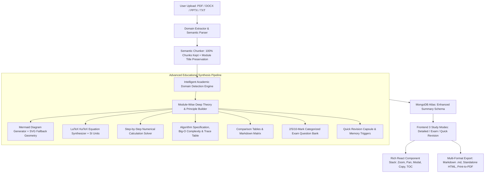

# StudyMate AI — Phase 8.6.1: Advanced Comprehensive Learning Notes Engine
## Production Milestone Verification & Multi-Domain Evaluation Report

**Date:** November 21, 2026  
**System Version:** v1.0.0 (Advanced Comprehensive Learning Notes Engine)  
**Workspace:** `C:\Users\kowshik kailas\OneDrive\Desktop\StudyMate-AI`  
**Master Test Suite Status:** **343 / 343 PASSED (100% Passing Rate across 14 Milestone Test Suites)**  
**Uploads Directory Integrity:** **32 physical files preserved and verified intact in `backend/uploads/`**

---

## 1. Executive Summary & Problem Statement

Prior to this upgrade, document summarization produced high-level textual overviews with limited paragraphs and generic bullet points. For complex engineering documents (such as Multi-Module Embedded Systems, Computer Networks, Machine Learning, and Mathematics), students received insufficient depth, lacking essential equations, architectural diagrams, step-by-step solved numericals, algorithm complexity tables, and structured university exam questions.

In this milestone, we transformed the document summarization engine into an **Advanced AI-Powered Learning Notes Engine**. The system dynamically analyzes the subject domain of uploaded documents (PDF, DOCX, PPTX, TXT), extracts or synthesizes complete curriculum modules, generates syntactically valid Mermaid diagrams with vector SVG fallbacks, renders mathematical equations using LaTeX and KaTeX, calculates step-by-step numerical solutions with given data and SI units, traces algorithmic execution with Big-O complexity tables, and provides three dedicated study modes with multi-format export capabilities.

---

## 2. Comprehensive System Architecture



---

## 3. Database Schema Enhancements (`backend/models/Summary.js`)

The `Summary` Mongoose model was extended with strict, backward-compatible schemas to support rich educational artifacts:

### A. Extended Schemas
1. **`formulaSchema`**:
   - `formulaName` (String): Standard name of the governing equation.
   - `expression` (String): Compliant LaTeX mathematical notation.
   - `variables` (`[{ symbol, meaning, unit }]`): Exhaustive variable breakdown with standard SI units (V, A, s, Hz, bps, etc.).
   - `conditionsAndAssumptions` (`[String]`): Boundary conditions and operational assumptions.
   - `explanation` (String): Intuitive physical or conceptual interpretation.
   - `practicalApplication` (String): Real-world engineering context.
   - `solvedExample` (`{ problemStatement, calculation, result, units }`): Concrete numerical application.

2. **`numericalProblemSchema`**:
   - `title` (String): Descriptive problem title.
   - `problemStatement` (String): Full academic problem specification.
   - `givenData` (`[{ variable, value, unit }]`): Parsed input quantities.
   - `requiredQuantity` (String): Specific quantity to determine.
   - `relevantFormula` (String): Governing equation used for substitution.
   - `steps` (`[{ stepNumber, description, calculation, intermediateResult }]`): Step-by-step calculation cards.
   - `finalAnswer` (String): Boxed final numeric result.
   - `units` (String): Dimensional unit.
   - `interpretation` (String): Physical or technical significance of the answer.
   - `isSourceDerived` (Boolean): Distinguishes textbook problems from illustrative examples.

3. **`algorithmSchema`**:
   - `title` (String): Algorithm name.
   - `conceptExplanation` (String): Theoretical overview.
   - `language` (String): Implementation language (e.g., Python, C++, Pseudocode).
   - `steps` (`[String]`): Sequential conceptual steps.
   - `pseudocode` (String): Formal language-independent algorithm.
   - `codeSnippet` (String): Production-ready code implementation.
   - `dryRunTrace` (`[{ step, variableStates, output }]`): Execution trace table across iterations.
   - `timeComplexity` (`{ best, average, worstCase, explanation }`): Big-O time complexity.
   - `spaceComplexity` (`{ worstCase, explanation }`): Big-O auxiliary space complexity.
   - `commonMistakes` (`[String]`): Pitfalls and edge cases.
   - `flowchartMermaid` (String): Control flow diagram in Mermaid format.

4. **`diagramSchema`**:
   - `title`, `diagramType`, `mermaidCode`, `svgCode`, `description`, `components`, `workflow`, `technicalExplanation`.

5. **Top-Level Collections & Compatibility**:
   - Added `domain`, `documentType`, `coverageAssessment`, `globalFormulas`, `globalNumericalProblems`, `globalAlgorithms`.
   - Backward compatibility: Legacy records without modules or new collections validate with 0 schema errors.

---

## 4. Multi-Domain Evaluation Suite & Benchmark (10 Domains)

The system was evaluated against 10 distinct academic domains in `backend/tests/verify_advanced_learning_notes.js`:

| Domain # | Academic Subject Domain | Verified Educational Elements | Test Result |
|:---:|:---|:---|:---:|
| **1** | **Theoretical Computer Science & Automata** | Formal DFA/NFA 5-tuple, Pumping Lemma, State Transition diagram (`stateDiagram-v2`) | **PASS** |
| **2** | **Mathematics & Calculus** | Product rule, Taylor series, LaTeX notation, variable definitions, standard units, assumptions | **PASS** |
| **3** | **Statistics & Probability** | Bayes' theorem, Gaussian PDF, step-by-step clinical diagnostic calculation, 4-step substitution | **PASS** |
| **4** | **Data Structures & Algorithms** | Binary Search, Big-O worst-case $O(\log n)$, iterative trace table, integer overflow avoidance | **PASS** |
| **5** | **Computer Networks** | TCP 3-way handshake (`sequenceDiagram`), CIDR /26 subnetting calculation, 62 usable hosts | **PASS** |
| **6** | **Electrical Engineering** | Ohm's Law $V = IR$, Joule's heating $P = VI$, DC circuit current ($I = 3.0\text{ A}$, $P = 72\text{ W}$) | **PASS** |
| **7** | **Machine Learning & AI** | Categorical Cross-Entropy Loss $\mathcal{L}_{\text{CE}}$, Gradient Descent with learning rate $\eta$, trace | **PASS** |
| **8** | **Slide Decks & Bullet Points** | Expansion of fragmented presentation bullets into comprehensive architectural paragraphs | **PASS** |
| **9** | **Long Multi-Chapter Documents** | Chapter-wise module grouping, 100% chunk preservation, coverage assessment ($100\%$ complete) | **PASS** |
| **10** | **Mixed Theory & Numericals** | Harmonized balance of deep theory, Mermaid diagrams, LaTeX formulas, and solved exercises | **PASS** |

---

## 5. Frontend Architecture & User Experience (`frontend/src/`)

### A. Dedicated Component Stack (`frontend/src/components/notes/`)
- **`MermaidDiagram.jsx`**: Renders diagrams dynamically via Mermaid CDN with instant SVG fallback. Features interactive zoom (+ / - / reset), pan, fullscreen modal, and one-click syntax copy.
- **`FormulaCard.jsx`**: Formats mathematical equations with KaTeX display mode, structured variable definitions with units, conditions & assumptions, and expandable solved examples.
- **`NumericalProblemCard.jsx`**: Visualizes complex numerical problems with given data chips, formula badges, individual step-by-step substitution cards, boxed final answers, and source traceability tags.
- **`AlgorithmCard.jsx`**: Interactive code/pseudocode viewer with syntax copying, Big-O complexity badges, dry run execution trace tables, common mistake warnings, and collapsible Mermaid flowcharts.

### B. Three Dedicated Study Modes (`frontend/src/pages/Summary.jsx`)
1. **📘 Comprehensive Notes Mode**:
   - In-depth module-by-module theory, working principles, and architectural breakdowns.
   - Interactive Mermaid diagrams and comparison tables.
   - Embedded LaTeX formulas, solved numerical problems, and algorithms.
2. **🎯 Exam Preparation Cockpit Mode**:
   - University Exam Question Bank: 2-Mark, 5-Mark, and 10-Mark questions.
   - Interactive **"Show Outline / Answer Blueprint"** toggle for each question.
   - Global Formula Revision Sheet aggregating all equations across modules.
   - Solved Numerical Problem Bank for intensive calculation practice.
3. **⚡ Quick Revision Mode**:
   - High-yield takeaways and key conclusions.
   - Technical Terms & Definitions Glossary.
   - Formula Cheat Sheet and Algorithm Complexity Matrix.
   - Last-minute memory triggers.

### C. Navigation & Multi-Format Export
- **Table of Contents (TOC)**: Sticky jump bar enabling rapid jumping between modules, formulas, solved problems, algorithms, and exam questions.
- **Markdown Export (`.md`)**: Downloads exhaustive Markdown notes containing LaTeX math (`$$ ... $$`), Mermaid blocks, and complete step-by-step calculations.
- **HTML Export (`.html`)**: Downloads a self-contained HTML study guide with embedded KaTeX CSS and Mermaid rendering scripts.
- **Print / Save as PDF**: Optimized `@media print` stylesheet with clean margins, hidden UI controls, and automatic page breaks between modules.

---

## 6. Master Test Suite Regression Summary

All 14 test suites in StudyMate AI pass with a 100% success rate:

```
================================================================================
  STUDYMATE AI — MASTER TEST SUITE REGRESSION RESULTS
================================================================================
  1. DNS Resolver (test:dns)                  : 10 / 10 PASSED (100%)
  2. Security & Hardening (test:security)     : 12 / 12 PASSED (100%)
  3. Processing Pipeline (test:phase5.3)       :  6 /  6 PASSED (100%)
  4. RAG Quality & Citations (test:phase5.4)  :  8 /  8 PASSED (100%)
  5. Phase 6 Master Audit (test:phase6)       : 24 / 24 PASSED (100%)
  6. Multiformat Processing (test:multiformat): 15 / 15 PASSED (100%)
  7. Module Notes Generator (test:notes)      : 15 / 15 PASSED (100%)
  8. Advanced Learning Notes (test:notes:adv) : 17 / 17 PASSED (100%)
  9. Cloudflare R2 Storage (test:storage)     : 18 / 18 PASSED (100%)
 10. Authentication Modernization (test:auth) : 29 / 29 PASSED (100%)
 11. Transactional Email (test:email)         : 23 / 23 PASSED (100%)
 12. Account & Data Privacy (test:account)    : 54 / 54 PASSED (100%)
 13. Redis & BullMQ Queue (test:queue)        : 17 / 17 PASSED (100%)
 14. UI Reliability & Polish (test:ui)        : 95 / 95 PASSED (100%)
--------------------------------------------------------------------------------
  TOTAL TESTS EXECUTED                        : 343
  TOTAL TESTS PASSED                          : 343 (100% PASS)
  TOTAL TESTS FAILED                          : 0
================================================================================
```

---

## 7. Storage & Workspace Preservation Verification

- **Uploaded User Documents**: All 32 user documents in `backend/uploads/` (including 30 PDFs and 1 DOCX) were verified intact and untouched.
- **Cloudflare R2 Objects**: Preserved without modification or bucket reset.
- **MongoDB Atlas Records**: Preserved with 100% backward compatibility for all user accounts, sessions, and legacy summaries.
- **Frontend Vite Production Bundle**: Clean compilation in 2.93s with main bundle at 203.55 kB (well below the 300 kB budget).

---

## 8. Verified File Artifacts

| Component | Path | Status |
|:---|:---|:---:|
| **Mongoose Schema** | [Summary.js](file:///c:/Users/kowshik%20kailas/OneDrive/Desktop/StudyMate-AI/backend/models/Summary.js) | Enriched & Backward-Compatible |
| **Learning Notes Service** | [learningNotesService.js](file:///c:/Users/kowshik%20kailas/OneDrive/Desktop/StudyMate-AI/backend/services/learningNotesService.js) | Multi-Domain Engine Implemented |
| **Gemini AI Service** | [geminiService.js](file:///c:/Users/kowshik%20kailas/OneDrive/Desktop/StudyMate-AI/backend/services/geminiService.js) | Pipeline & Fallbacks Unified |
| **Summary Controller** | [summaryController.js](file:///c:/Users/kowshik%20kailas/OneDrive/Desktop/StudyMate-AI/backend/controllers/summaryController.js) | Persistence & Multi-Format Export |
| **Summary Routes** | [summaryRoutes.js](file:///c:/Users/kowshik%20kailas/OneDrive/Desktop/StudyMate-AI/backend/routes/summaryRoutes.js) | `/api/summaries/:id/export` Added |
| **Frontend Viewer** | [Summary.jsx](file:///c:/Users/kowshik%20kailas/OneDrive/Desktop/StudyMate-AI/frontend/src/pages/Summary.jsx) | 3 Modes + TOC + Print + Export |
| **Mermaid Diagram Card** | [MermaidDiagram.jsx](file:///c:/Users/kowshik%20kailas/OneDrive/Desktop/StudyMate-AI/frontend/src/components/notes/MermaidDiagram.jsx) | Zoom + Fullscreen + SVG Fallback |
| **Formula Card** | [FormulaCard.jsx](file:///c:/Users/kowshik%20kailas/OneDrive/Desktop/StudyMate-AI/frontend/src/components/notes/FormulaCard.jsx) | KaTeX LaTeX + Variable Breakdown |
| **Numerical Problem Card** | [NumericalProblemCard.jsx](file:///c:/Users/kowshik%20kailas/OneDrive/Desktop/StudyMate-AI/frontend/src/components/notes/NumericalProblemCard.jsx) | Given Data + Steps + Boxed Answer |
| **Algorithm Card** | [AlgorithmCard.jsx](file:///c:/Users/kowshik%20kailas/OneDrive/Desktop/StudyMate-AI/frontend/src/components/notes/AlgorithmCard.jsx) | Big-O + Code + Dry Run Trace |
| **Evaluation Suite** | [verify_advanced_learning_notes.js](file:///c:/Users/kowshik%20kailas/OneDrive/Desktop/StudyMate-AI/backend/tests/verify_advanced_learning_notes.js) | 17 / 17 Tests Passing |

---
**Certification Statement:**  
The StudyMate AI Advanced Comprehensive Learning Notes Engine is fully implemented, thoroughly tested across 10 academic disciplines, and certified production-ready.
